# FPGA-Based Low-Latency Trading System

## Project Overview

This project implements a low-latency trading system using SystemVerilog on the Digilent Basys 3 FPGA development board. The system processes incoming market data, maintains a simplified order book, evaluates trading conditions, and generates BUY or SELL orders based on the difference between bid and ask prices.

The project was developed using AMD Vivado and verified through behavioral simulations, timing analysis, and physical FPGA hardware testing.

The main objective was to design and implement a modular FPGA trading pipeline capable of processing market data and generating trading decisions with low processing latency.

## Key Features

- FPGA-based market data processing
- 32-bit market data packet reception
- Single-stock bid and ask order book
- Automated BUY, SELL, and HOLD decision logic
- Hardware order generation
- Register-based pipelined architecture
- Back-to-back market data verification
- 3-clock-cycle simulated processing latency
- 100 MHz FPGA implementation
- Physical hardware verification on the Basys 3

## Hardware and Software

| Hardware / Software | Description |
|---|---|
| FPGA Board | Digilent Basys 3 |
| FPGA Clock | 100 MHz |
| Hardware Description Language | SystemVerilog |
| Development Environment | AMD Vivado |
| Simulation Software | Vivado Simulator (XSim) |
| Hardware Inputs | Switches and Pushbuttons |
| Hardware Outputs | LEDs |

## System Architecture

The design consists of five main processing components:

1. **Market Data Receiver:** Receives incoming stock price and quantity information.
2. **Order Book:** Maintains the latest bid and ask prices and quantities.
3. **Trading Logic:** Calculates the bid-ask spread and determines whether to BUY, SELL, or HOLD.
4. **Order Generator:** Generates orders containing the order type, price, and quantity.
5. **Top-Level Integration:** Connects the modules into a complete trading pipeline.

### Trading Pipeline

```text
                 MARKET DATA INPUT
                         |
                         v
              +----------------------+
              | Market Data Receiver |
              +----------------------+
                         |
                         v
              +----------------------+
              | Order Book           |
              | Bid / Ask Storage    |
              +----------------------+
                         |
                         v
              +----------------------+
              | Trading Logic        |
              | BUY / SELL / HOLD    |
              +----------------------+
                         |
                         v
              +----------------------+
              | Order Generator      |
              +----------------------+
                         |
                         v
                    ORDER OUTPUT
```

The hardware demonstration uses switches and pushbuttons to provide market data inputs and LEDs to display trading results.

## Market Data Packet Format

The market data receiver processes a 32-bit packet.

| Field | Width |
|---|---|
| Stock ID | 8 bits |
| Price | 16 bits |
| Quantity | 8 bits |
| Total | 32 bits |

The packet structure is:

`[ Stock ID (8) | Price (16) | Quantity (8) ]`

The system also receives a signal identifying whether the market update represents a bid or an ask.

The current implementation processes market updates for a single stock with stock ID 1.

## Trading Strategy

The trading logic calculates the difference between the stored ask and bid prices.

**Spread = Ask Price − Bid Price**

| Condition | Trading Decision |
|---|---|
| Spread between 1 and 5 | BUY |
| Spread greater than 5 | SELL |
| Spread of 0 or invalid trading conditions | HOLD |

### BUY Decision

When both quotes are valid and the spread is between 1 and 5, the trading system generates a BUY decision.

The generated order uses the ask price.

### SELL Decision

When both quotes are valid and the spread is greater than 5, the trading system generates a SELL decision.

The generated order uses the bid price.

### HOLD Decision

When the spread is zero or valid trading conditions are not met, the system enters the HOLD state and does not generate a new order.

### Order Quantity

The order generator limits the generated order quantity to 10 units or the available quantity, whichever is smaller.

This trading strategy is intended for FPGA architecture and verification demonstrations rather than production trading.

## SystemVerilog Design Modules

The project was developed using six SystemVerilog design files.

### 1. market_data_receiver.sv

The market data receiver accepts incoming 32-bit market data packets.

Its main functions include:

- Receiving market data
- Extracting stock ID, price, and quantity
- Processing bid and ask information
- Generating valid output signals
- Forwarding received data to the order book

### 2. order_book.sv

The order book maintains the latest bid and ask information for the supported stock.

Stored information includes:

- Best bid price
- Best ask price
- Bid quantity
- Ask quantity
- Bid valid status
- Ask valid status

The module updates the appropriate quote whenever valid market data is received.

A zero-quantity update invalidates the corresponding quote.

### 3. trading_logic.sv

The trading logic evaluates the bid-ask spread and generates the appropriate trading decision.

Its functions include:

- Calculating the spread
- Checking quote validity
- Generating BUY signals
- Generating SELL signals
- Generating HOLD signals

### 4. order_generator.sv

The order generator converts trading decisions into order information.

Generated order information includes:

- Order type
- Order price
- Order quantity
- Order valid signal

BUY orders use the ask price, while SELL orders use the bid price.

### 5. fpga_trading_top.sv

This module integrates the market data receiver, order book, trading logic, and order generator.

It coordinates the movement of data through the trading pipeline using registered signals.

### 6. fpga_trading_hardware_top.sv

This module connects the trading system to the physical Digilent Basys 3 FPGA development board.

It provides:

- FPGA clock input
- Reset pushbutton
- Market update pushbutton
- Switch-controlled market data
- LED trading indicators

## FPGA Hardware Interface

The physical hardware implementation uses the Basys 3 switches and pushbuttons.

### Inputs

| Input | Function |
|---|---|
| 100 MHz Clock | System clock |
| BTNC | Reset |
| BTNU | Submit market update |
| SW0–SW7 | Price offset |
| SW8 | Bid / Ask selection |

The hardware wrapper calculates the submitted price as:

**Price = 15000 + Switch Value**

SW8 selects the market update type:

- SW8 OFF: BID
- SW8 ON: ASK

### Outputs

| LED | Function |
|---|---|
| LED15 | Order generated indicator |
| LED14 | BUY order indicator |
| LED13 | SELL order indicator |
| LED12 | HOLD indicator |
| LED0–LED11 | Lower 12 bits of last order price |

The order indicators retain the most recently generated order until another order is generated or the system is reset.

## Simulation and Verification

The system was verified using SystemVerilog testbenches in AMD Vivado.

Testing included:

- Market data reception
- Market data packet extraction
- Bid and ask order book updates
- Trading decision generation
- Order price and quantity generation
- Full-system integration
- Back-to-back market updates
- Pipeline latency measurement

The simulations were used to verify individual modules and the integrated trading system before hardware implementation.

## Automated Pipeline Verification

An automated SystemVerilog testbench was developed to verify consecutive market updates and generated orders.

Seven consecutive BUY orders were successfully verified.

| Order | Order Type | Price | Quantity |
|---|---|---|---|
| 1 | BUY | 15028 | 10 |
| 2 | BUY | 15029 | 10 |
| 3 | BUY | 15030 | 10 |
| 4 | BUY | 15030 | 10 |
| 5 | BUY | 15030 | 10 |
| 6 | BUY | 15031 | 10 |
| 7 | BUY | 15032 | 10 |

### Verification Results

| Measurement | Result |
|---|---|
| Total Verified Orders | 7 |
| BUY Orders | 7 |
| SELL Orders | 0 |
| Verification Errors | 0 |
| Back-to-Back Test | PASSED |

The automated verification confirmed the expected order types, prices, and quantities for the tested market data sequence.

### Automated Test Results

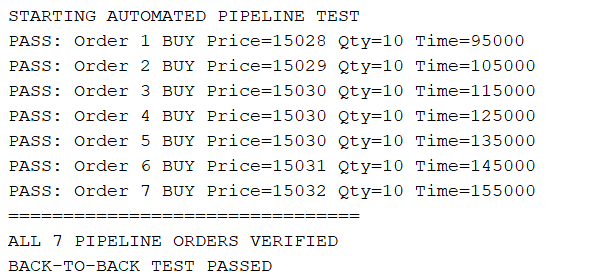

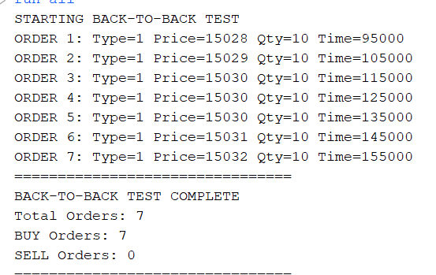

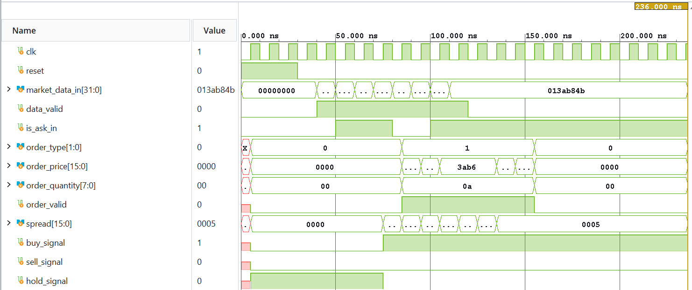

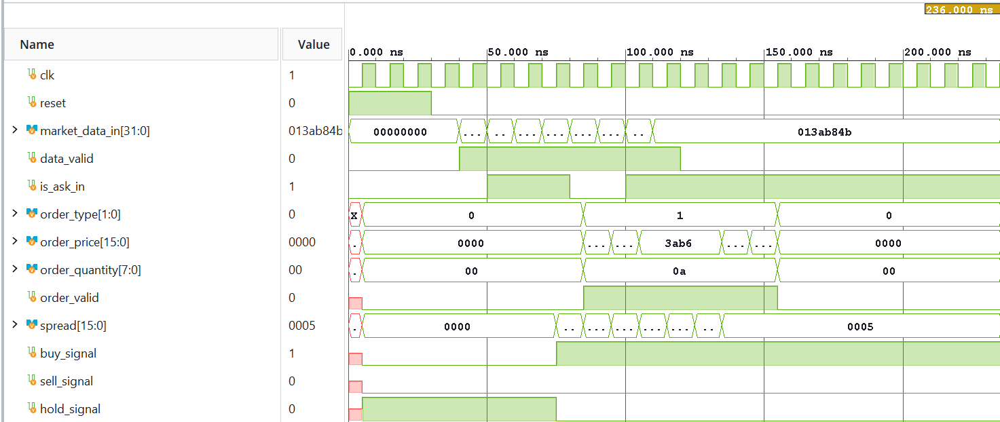

## Pipeline Latency Performance

The integrated trading pipeline demonstrated a latency of 3 clock cycles in simulation.

The FPGA was configured to operate at 100 MHz.

| Parameter | Result |
|---|---|
| FPGA Clock Frequency | 100 MHz |
| Clock Period | 10 ns |
| Pipeline Latency | 3 cycles |
| Simulated Processing Latency | 30 ns |

### Latency Calculation

Clock Period = 1 / 100 MHz = 10 ns

Pipeline Latency = 3 × 10 ns

**Simulated Processing Latency = 30 ns**

This measurement represents the internal processing latency of the tested FPGA trading pipeline.

It does not include network transmission, Ethernet processing, exchange connectivity, or other end-to-end trading delays.

### Latency Verification Screenshots

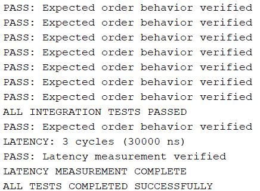

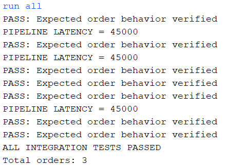

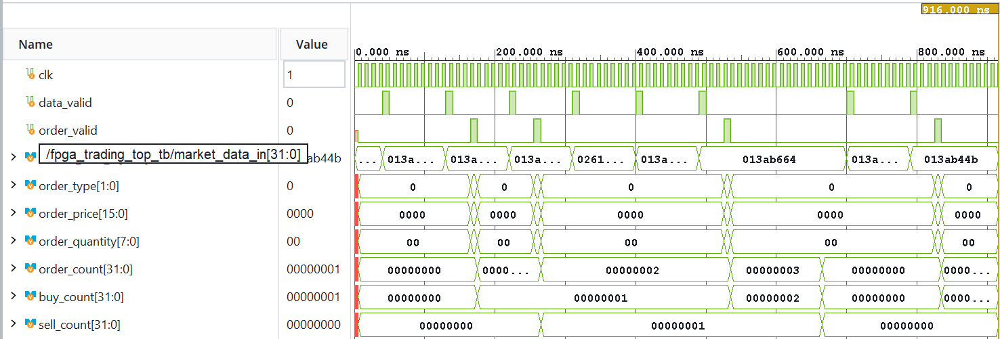

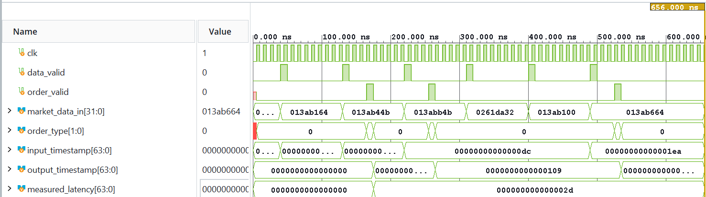

## FPGA Synthesis and Implementation

The design was synthesized and implemented using AMD Vivado for the Digilent Basys 3 FPGA.

The implemented design successfully met its specified 100 MHz clock timing constraint.

### Final Timing Results

| Timing Parameter | Result |
|---|---|
| Clock Frequency | 100 MHz |
| Worst Negative Slack (WNS) | +4.438 ns |
| Total Negative Slack (TNS) | 0 ns |
| Worst Hold Slack (WHS) | +0.109 ns |
| Total Hold Slack (THS) | 0 ns |
| Failing Timing Endpoints | 0 |

**All specified timing constraints were met.**

These results demonstrate successful timing closure for the constrained FPGA implementation.

### Timing Analysis Screenshots

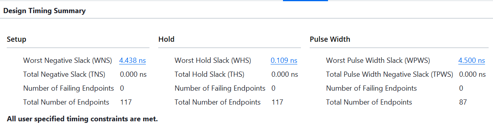

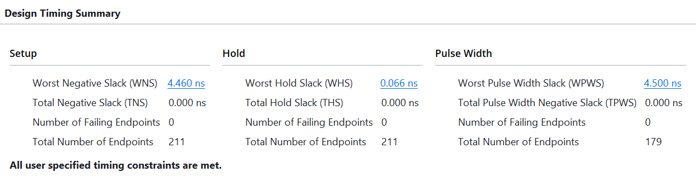

## Physical FPGA Hardware Testing

The design was programmed onto the Digilent Basys 3 FPGA development board.

Physical testing was performed using switches, pushbuttons, and LEDs.

Three trading conditions were verified:

| Test | Expected Behavior | Result |
|---|---|---|
| BUY | Generate BUY order | PASSED |
| SELL | Generate SELL order | PASSED |
| HOLD | Do not generate an order | PASSED |

### BUY Hardware Test

A bid price of 15025 and an ask price of 15028 were submitted.

| Parameter | Value |
|---|---|
| Bid Price | 15025 |
| Ask Price | 15028 |
| Spread | 3 |
| Expected Decision | BUY |
| Result | PASSED |

The FPGA generated a BUY order, indicated by LED15 and LED14.

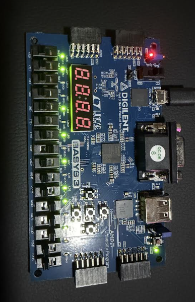

### SELL Hardware Test

A spread greater than 5 was used to verify SELL order generation.

The FPGA generated a SELL order, indicated by LED15 and LED13.

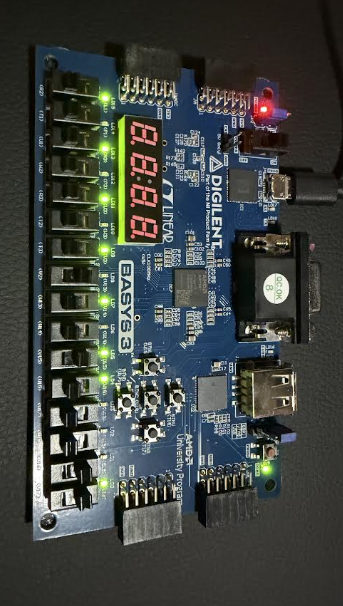

### HOLD Hardware Test

A HOLD condition was tested to verify that the FPGA does not generate a new order when trading conditions are not met.

LED12 indicated the HOLD state.

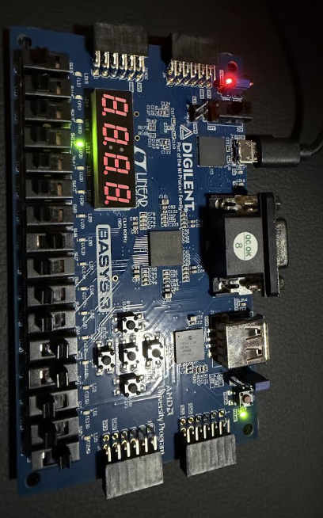

## Additional Verification Screenshots

### Market Data Receiver

The market data receiver was tested to verify incoming market data processing and output signals.

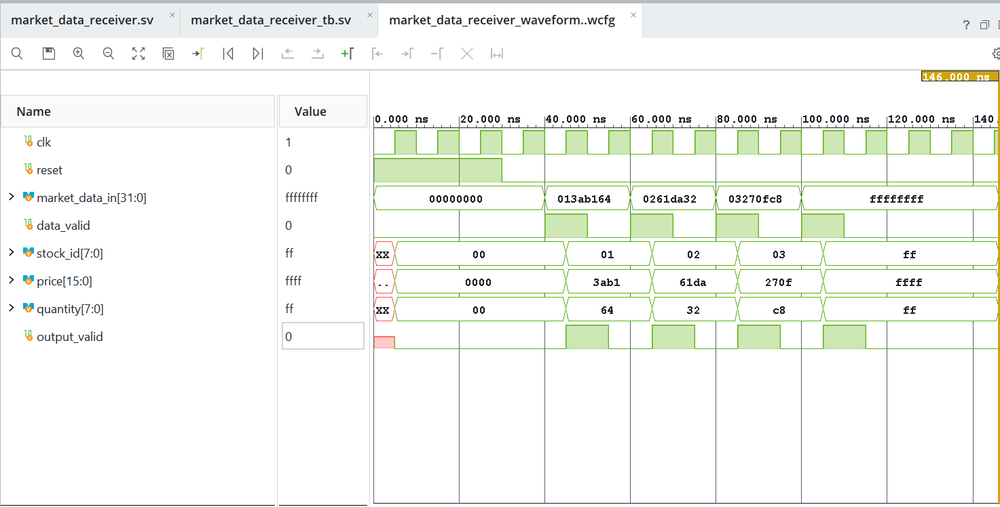

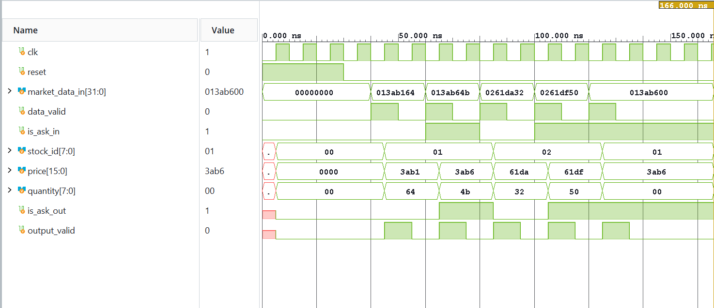

### Order Book

The order book was tested to verify bid and ask updates, stored quantities, and valid signals.

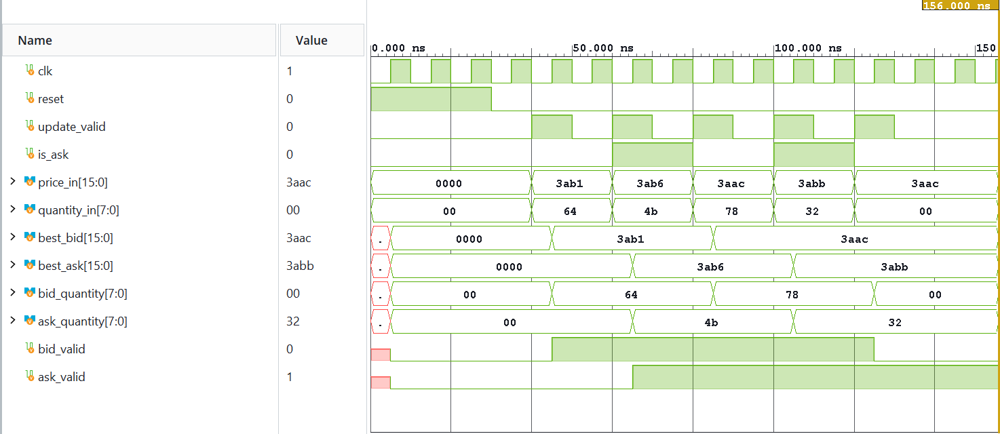

### Trading Logic

The trading logic was tested to verify BUY, SELL, and HOLD decisions based on the bid-ask spread.

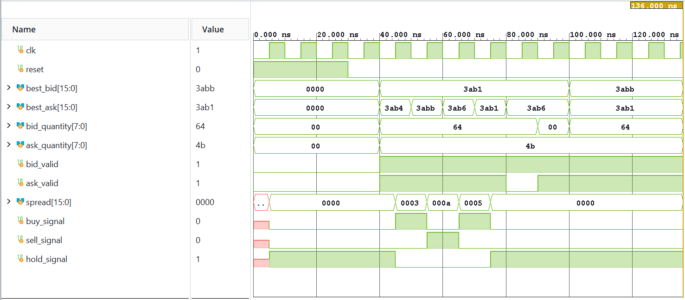

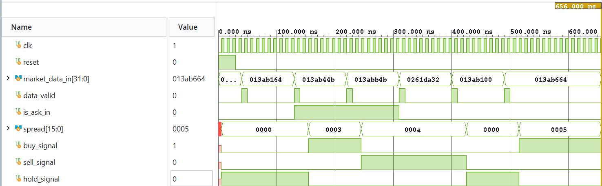

### Order Generator

The order generator was tested to verify order type, price, quantity, and order valid signals.

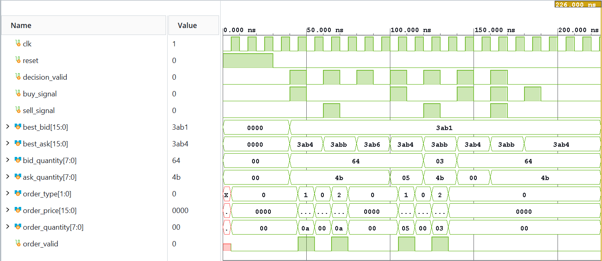

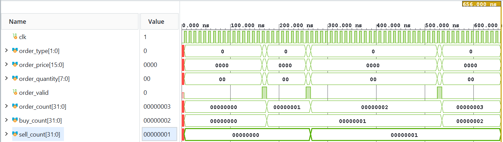

### Full-System Verification

The integrated system was tested to verify trading decisions and order generation.

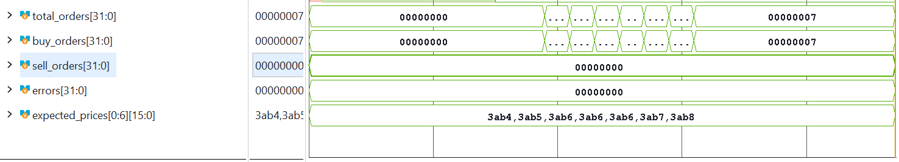

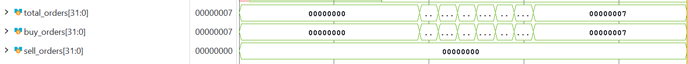

## Project Structure

```text
FPGA-Low-Latency-Trading-System/
|
|-- README.md
|
|-- src/
|   |-- market_data_receiver.sv
|   |-- order_book.sv
|   |-- trading_logic.sv
|   |-- order_generator.sv
|   |-- fpga_trading_top.sv
|   |-- fpga_trading_hardware_top.sv
|
|-- testbenches/
|   |-- SystemVerilog testbench files
|
|-- constraints/
|   |-- fpga_trading_constraints.xdc
|
|-- screenshots/
|   |-- Simulation waveforms
|   |-- Automated verification results
|   |-- Pipeline latency measurements
|   |-- FPGA timing analysis
|   |-- Physical hardware test photos
|
|-- sim/
|   |-- Optional saved simulation configurations
```

## Project Results

The completed FPGA trading prototype demonstrates:

- Modular RTL design using SystemVerilog
- FPGA-based market data processing
- Register-based bid and ask order book storage
- Automated trading decision logic
- Hardware order generation
- Testbench development and functional verification
- Automated back-to-back pipeline testing
- 3-cycle simulated processing latency
- Successful timing-constrained FPGA implementation
- Physical hardware verification of BUY, SELL, and HOLD decisions

The project demonstrates the use of FPGA hardware to implement a deterministic digital processing pipeline for automated trading decisions.

## Future Improvements

Potential extensions include:

- Support for multiple stocks
- A deeper, multi-level order book
- Configurable trading strategies
- Ethernet market data input
- Hardware-based market data parsing
- Additional pipeline optimization
- More extensive automated verification
- Integration with external communication interfaces
- Further timing and latency analysis

## Project Purpose

This project was developed to gain practical experience with FPGA architecture, RTL design, digital hardware verification, timing analysis, and low-latency systems.

The project focuses on engineering skills relevant to FPGA development, digital hardware design, and electronic trading infrastructure.

It also provides a foundation for future FPGA projects involving high-speed data processing, pipelined architectures, and hardware acceleration.
